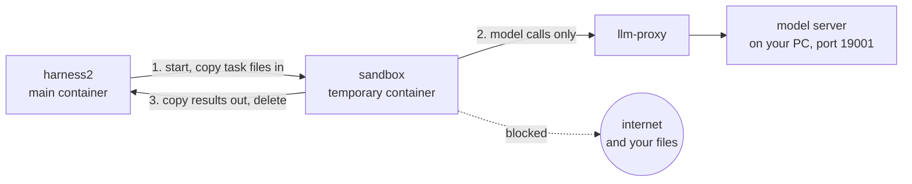

# Harness² (local model)

Upstream: <https://github.com/google-research/harness2> (commit `1cfe254e8d25b15f37048c3730134686abe60335`)

Run every command from `src/harness2/docker`.

## 1. Install

```bash
git clone -c core.autocrlf=false https://github.com/google-research/harness2.git module
git -C module checkout 1cfe254e8d25b15f37048c3730134686abe60335
git -C module apply ../provider-refactor.patch
git -C module apply ../sandbox.patch          # sandbox, see section 4

docker compose build harness2 sandbox
cp harness2.env.example harness2.env

docker compose run --rm harness2              # smoke test, no model needed
# expect: Local demo: 2 tasks completed; 0 failed
```

## 2. Pick models

Edit `harness2.env`:

```bash
HARNESS2_PROVIDER_BASE_URL=http://llm-proxy:19001/v1   # llm-proxy -> your model server (port 19001)
HARNESS2_PROVIDER_API_KEY=
HARNESS2_SANDBOX=docker                # docker or local (section 4)
HARNESS2_SOLVER_MODEL=local/sonnet     # runs the task
HARNESS2_IMPROVER_MODEL=local/sonnet   # improves the harness
HARNESS2_JUDGE_MODEL=local/sonnet      # scores the result
# HARNESS2_PROVIDER_CONTEXT=131072     # set to the real context of ONE server slot
# HARNESS2_PROVIDER_OUTPUT=16384
```

Model name is `local/<id on your server>`.

- llama-server: one slot has `--ctx-size` / `--parallel` tokens. If `HARNESS2_PROVIDER_CONTEXT` is bigger, long tasks overflow.
- One slot runs one job at a time. Don't start two experiments together.
- Changed the model? Start a new session (below).

### Where runs are stored

Every run is a session: one `docker compose run` (a shell, a script, the demo) or one API job.
Each session gets its own folder, `docker/runs/<session-id>/` (git-ignored), with the same layout:

```
runs/<session-id>/             id: <UTC yyyymmdd-hhmmss>-<4 hex>, e.g. 20261025-091502-3fa1
├── session.json               kind (cli / task / demo), command, models, state, times, exit codes
├── log.txt                    all output
├── jb/                        harness2's files (HARNESS2_RUNS_DIR points at the session folder)
│   ├── dataset/<domain>/<task>/   attempts, outputs, scores ("Where the results are" below)
│   ├── adapt/                     improver notes and candidate harnesses
│   └── library/                   lessons
└── demo/                      harness2-demo only
```

- The container prints the id first: `[session] 20261025-091502-3fa1 -> runs/20261025-091502-3fa1/`.
- Sandbox containers are named `h2sbx-<session-id>-<6 hex>`.
- Sessions share nothing. Lessons only add up between tasks of the same session.
- Continue a stopped session: `docker compose run --rm -e HARNESS2_SESSION_ID=<id> harness2 ...`.
- `state` stays `running` with no `finished` when the container was killed.
- Don't set `HARNESS2_RUNS_DIR` yourself. The session sets it (`session.sh`, the image's entrypoint).

## 3. Usage

Open a shell in the container (the shell is one session):

```bash
docker compose run --rm harness2 bash
```

### Make a task

```
tasks/<domain>/<task>/
├── task_folder/
│   ├── TASK_INSTRUCTIONS.txt    what to do; say the files go in output/
│   └── <input files>
└── RUBRICS.json                 how to score it
```

```json
{"rubrics": [{"rubric": "What to check", "weight": 10, "criterion": ["Condition 1", "Condition 2"]}]}
```

### Run, score, report

```bash
harness2-setup jb                                          # first time only
cp -r tasks/* dependencies/job-bench-eval/dataset/main/    # after every task change
harness2-check --bench jb                                  # check the setup

harness2 --bench jb --only-domains local_eval --k 1 --mode parallel --dry-run   # preview
harness2 --bench jb --only-domains local_eval --k 1 --mode parallel             # run
harness2-judge  --bench jb --k 1 --mode parallel
harness2-report --bench jb --k 1 --mode parallel
```

| Option | Meaning |
|---|---|
| `--k K --mode parallel` | try K candidate harnesses side by side |
| `--k K --mode sequential` | improve in K rounds, one after another |
| `--only-domains <d>` | only these domains |
| `--max-tasks N` | at most N tasks per domain |
| `--workers N` / `--seed N` | N domains at once / fix the task order |

- Use the same `--k`, `--mode`, `--seed` for run, judge and report.
- Stopped halfway? Run the same command again in the same session. It picks up where it left off.

### One task only

`--only-domains` takes domains, not tasks. Copy the task into its own domain:

```bash
D=dependencies/job-bench-eval/dataset/main
mkdir -p $D/t2_only && rm -rf $D/t2_only/t2_medium && cp -r tasks/local_eval/t2_medium $D/t2_only/
harness2 --bench jb --only-domains t2_only --k 1 --mode parallel
```

### Run in the background, and stop

```bash
docker compose run -d --rm harness2 bash -c '
  harness2 --bench jb --only-domains local_eval --k 1 --mode parallel
  harness2-judge  --bench jb --k 1 --mode parallel
  harness2-report --bench jb --k 1 --mode parallel'

ls -t runs | head -1                                       # the newest session is this one
tail -f runs/<session-id>/log.txt                          # follow it
docker stop $(docker ps -q --filter name=harness2-run)     # stop (model server keeps running)
```

### Where the results are

```
runs/<session-id>/jb/dataset/<domain>/<task>/
├── model_traj/<label>/                   every attempt (.jsonl)
├── model_output/<label>/                 the files the agent made
└── eval_result/eval_<label>/<judge>_judge.json   the judge's score
```

`<label>` ends with `base1` (original harness), `inv1` / `dom1` (two candidates) or `agg1` (final harness).

### Read the result

| In the log | Means |
|---|---|
| `N/N ok` | done. The best candidate is scored |
| `base-failed` | the first run made no files (2 tries, `MAX_RETRIES` in `module/harness2/benchmarks/jobbench.py`). Nothing to learn from, so the task is skipped and not scored |
| `partial ... no candidate produced an artifact` | no candidate made files. The judge says *ungraded*, not 0 |

`harness2` exits with 2 if any task is not `ok`. Don't chain judge and report with `&&`. Use a new line or `;`.

### Look at a trajectory

A web viewer for every attempt under `runs/`. Run it on your PC, not in the container (from `docker/`):

```bash
uv run tools/traj_viewer.py                 # installs gradio on first use, prints the URL (http://127.0.0.1:7860)
uv run tools/traj_viewer.py --port 7861     # a fixed port
uv run tools/traj_viewer.py --runs <dir>    # another runs folder
```

No `uv`? Use any Python with `gradio>=6` and `pandas`: `python tools/traj_viewer.py`.

Pick an attempt (`session · task · label · attempt`, type to filter). **Refresh** finds new runs.

| Tab | Shows |
|---|---|
| (top) | start, duration, steps, tool calls, errors, max input tokens, output tokens |
| Conversation | the model's text and each tool call (❌ = failed); open one to see its input and output |
| Timeline | one row per event: time, step, type, status, summary |
| Tokens | input and output tokens per step. Input near the server's `--ctx-size` means the context is full |
| Deliverables | the files in `model_output/<label>/` |
| Judge | each rubric and criterion, passed or not, and the judge's reason |
| Raw events | one event's JSON by number |

It only reads files. Port taken? Without `--port` it takes the next free one.

### One task, no improvement

```bash
export OPENCODE_CONFIG_CONTENT="$(python -c 'import os; from harness2 import config; print(os.environ["OPENCODE_CONFIG_CONTENT"])')"
W=$HARNESS2_RUNS_DIR/direct/t1_easy
mkdir -p $W && cp -r tasks/local_eval/t1_easy/task_folder/* $W/
/opt/harness2/dependencies/tools/node_modules/.bin/bun run \
  --cwd /opt/harness2/dependencies/opencode/packages/opencode --conditions=browser src/index.ts \
  run "$(cat $W/TASK_INSTRUCTIONS.txt)" --dir $W --model local/sonnet </dev/null
# files: runs/<session-id>/direct/t1_easy/output/
```

This runs in the main container (no sandbox) and the judge does not score it.

## 4. Sandbox

The agent runs your task inside a small throwaway Docker container, not the main one. It can use its task files and call the model. That's all. The container is deleted when it ends.

Why: the agent runs code and shell commands by itself. In the sandbox it can't see `RUBRICS.json`, other runs or your source code, and it can't reach the internet.

```bash
HARNESS2_SANDBOX=docker      # agent runs in the sandbox (harness2.env)
HARNESS2_SANDBOX=local       # agent runs in the main container, like upstream
```



| The agent can | The agent can't |
|---|---|
| read and write its own task folder | use the internet or reach your PC |
| call the model through `llm-proxy` | see datasets, `RUBRICS.json`, `runs/`, `tasks/` or harness2 code |
| use Python (pandas, numpy, openpyxl, XlsxWriter, python-docx, python-pptx, pdfplumber, matplotlib), pandoc, pdftotext, ripgrep | install tools (no internet for pip and npm) |
| | see other runs, your gcloud login or the Docker socket |

Check it:

```bash
docker compose run --rm harness2 python -m harness2.sandbox
# expect: model reachable, internet and Docker socket blocked, RUBRICS.json files 0, backend=docker exit=0
```

| I want to | Do this |
|---|---|
| add a tool for the agent | add it to `Dockerfile.sandbox`, then `docker compose build sandbox` |
| more CPU or memory | `HARNESS2_SANDBOX_CPUS` (default 4), `HARNESS2_SANDBOX_MEMORY` (default 4g) |
| model on another PC | `HARNESS2_LLM_UPSTREAM=<host>:<port>` in the shell or `docker/.env` |
| remote model (Vertex) | `HARNESS2_SANDBOX=local` (the sandbox has no internet) |
| stop `llm-proxy` | `docker compose down` (also stops `harness2-api`) |

- A killed run leaves a sandbox behind. The next run cleans it up.
- Code: `harness2/sandbox.py` (from `sandbox.patch`).

## 5. How the improvement works

harness2 changes the harness around the model (system prompt, skills, scripts). The model itself never changes. One local model fills every role by default:

| Role | Setting | Does |
|---|---|---|
| Executor | `HARNESS2_SOLVER_MODEL` | runs the task |
| Improver | `HARNESS2_IMPROVER_MODEL` | proposes edits, builds the final harness, picks the best, writes lessons |
| Judge | `HARNESS2_JUDGE_MODEL` | scores the result with `RUBRICS.json` |

For each task:

```
1. base      run the task with the original harness
2. inv1      improver edit: how to work       -> run again
3. dom1      improver edit: what an expert knows -> run again
4. agg1      improver merges the edits into one harness -> run again
5. deliver   k=1: agg1 is delivered as it is (no choice step). More candidates: a blind pick
6. learn     save lessons to runs/<session-id>/jb/library/jb/k<K>-oc/  (later tasks of the domain in this session reuse them)
```

- Step 1 must make files. If the base run makes nothing (`base-failed`), steps 2-6 never happen.
- Same domain, many tasks: that's how the lessons add up (`local_eval` has 3).
- The improver never sees the rubric or the right answer. It can only judge by how a result looks, so it can
  think a wrong answer is right. It may also answer `KEEP_BASE` (change nothing); then `agg1` is the original harness.
- The same blindness applies to learn: a wrong guess can be saved as a lesson.
- The judge is the same small model as the executor. Check a few of its scores by hand.
- The improver's own session does not run in the sandbox. Only executor runs do.

The original (base) harness already has 5 rules: read all inputs, do every calculation with a Python script, no subagent,
fix script errors, check `output/` before you finish. They come from `provider-refactor.patch`.

```bash
module/third_party/jb_runner/harness_baseline_oc/guardrails.md   # edit the rules here (always on, every run)
```

Test on `t1_easy` (`local/opus`, 8 runs each): with the rules 8 of 8 runs used code and 8 of 8 were right. Without them 3 of 8 used
code and 5 of 8 were right. Small sample.

Changed `module/`? Make the patch again (run in `docker/`):

```bash
S="harness2/sandbox.py harness2/benchmarks/jb_opencode_runner.py"
git -C module add -N harness2/sandbox.py
git -C module diff --binary -- $S > sandbox.patch
git -C module diff --binary -- . $(printf " :!%s" $S) > provider-refactor.patch
```

Why did my harness not change? Read what the improver said:

```bash
# in runs/<session-id>/jb/adapt/
_audit/jb-oc-agg1/*.response.md                                  # improver notes: inv1, dom1, agg1 (KEEP_BASE = no change)
jb-oc-agg1/<domain>__<task>/reflection/agg1/edits.md             # what each edit did
jb-oc-agg1/<domain>__<task>/harnesses/<label>/                   # the harness of each candidate
```

Optional: turn off OpenCode's subagent tool (`task`). Small models often call it with missing arguments, or hand off work and never check it.

```bash
docker compose run --rm -e 'OPENCODE_CONFIG_CONTENT={"permission":{"task":"deny"}}' harness2 bash
```

harness2 merges this with its own config and the sandbox passes `OPENCODE_*` variables on. The improver's session should get it too (not checked). Whether it helps is not proven: tried once per setting.

## 6. API server

`harness2-api` is harness2 as an always-on HTTP service (`docker/api/server.py`, no extra packages). Send a task, it runs `harness2`, `harness2-judge` and `harness2-report`, one job at a time. It only queues and reports. It does not change how harness2 improves.

```bash
docker compose up -d harness2-api            # http://127.0.0.1:8765  (not plain `up -d`: that starts everything)
python api/client.py health                  # models and queue
python api/client.py demo --wait             # harness2-demo on the server, no model
python api/client.py task tasks/local_eval/t1_easy --wait --fetch out/    # real task
python api/client.py task tasks/local_eval/t1_easy --dry-run --wait       # preview only
```

Python:

```python
import sys; sys.path.insert(0, "api")
from client import Harness2Client

h = Harness2Client()                         # reads $HARNESS2_API_URL and $HARNESS2_API_TOKEN
job = h.submit_task(
    instructions="numbers.csv lists amounts. Write output/summary.md with their total.",
    files={"numbers.csv": "item,amount\nA,1.50\nB,2.50\n"},     # files go in task_folder/
    rubrics={"rubrics": [{"rubric": "Total is 4.00?", "weight": 10, "criterion": ["Total is 4.00"]}]},
    k=1, mode="parallel",
)
job = h.wait(job["id"], on_update=print)     # queued -> running -> completed
print(job["outcome"], job["scores"])         # ok / base-failed / partial, and the judge score
h.fetch_outputs(job["id"], "out/")           # save the files of the scored candidate
```

curl (add `-H "Authorization: Bearer $HARNESS2_API_TOKEN"` if you set a token; `files` values are base64):

```bash
curl -s localhost:8765/health
curl -s -X POST localhost:8765/jobs -H 'Content-Type: application/json' -d '{
  "kind": "task", "instructions": "Write output/hello.txt containing hi.", "k": 1}'    # -> {"id": "<id>", ...}
curl -s localhost:8765/jobs/<id>                          # state, outcome, scores
curl -s "localhost:8765/jobs/<id>/log?tail=50"
curl -s localhost:8765/jobs/<id>/outputs                  # files per candidate
curl -s localhost:8765/jobs/<id>/outputs/<label>/hello.txt -o hello.txt
curl -s -X DELETE "localhost:8765/jobs/<id>"              # cancel a running job
curl -s -X DELETE "localhost:8765/jobs/<id>?purge=1"      # delete a finished task's files
```

A small task takes about 10 minutes with `k=1`.

| Endpoint | Does |
|---|---|
| `POST /jobs` | send a job (`kind` is `task` or `demo`) |
| `GET /jobs`, `GET /jobs/<id>` | jobs; state, `outcome`, `scores`, `selected` |
| `GET /jobs/<id>/log?tail=N` | command output |
| `GET /jobs/<id>/outputs[/<label>/<path>]` | list files / download one |
| `DELETE /jobs/<id>[?purge=1]` | cancel / delete files |
| `GET /health` | models and queue (no token needed) |

- `state`: `queued`, `running`, `completed`, `failed`, `cancelled`, `interrupted` (server restarted). `completed` only means the commands ran. Look at `outcome` for the real result (section 3).
- A job is a session: its id is the session id and its domain. Nothing carries over between jobs, lessons included.
  For lessons to add up, run the tasks in one CLI session (section 3).
- Rubrics go in `rubrics`, never in `files` (the agent can see files; the server says no). No `rubrics` means no scoring.
- `dry_run=True`: stage, preview, then delete.
- Results: `runs/<id>/jb/dataset/<id>/<name>/model_output/<label>/` (all four candidates). Log: `runs/<id>/log.txt`.
- The container has the Docker socket, so the port is on `127.0.0.1` only and there is no TLS. To ask for a token, set `HARNESS2_API_TOKEN` in `harness2.env`. Change the port with `HARNESS2_API_PORT`.
- Edited `api/server.py`? Run `docker compose restart harness2-api`.
