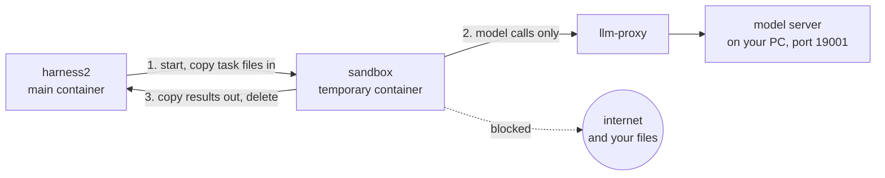
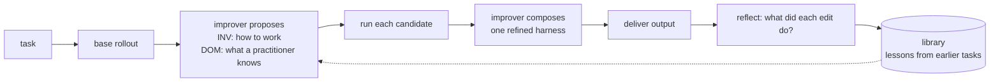

# Harness² (local model version)

Upstream repo: <https://github.com/google-research/harness2> (commit `1cfe254e8d25b15f37048c3730134686abe60335`)

Run all commands below from `src/harness2/docker`.

## 1. Install

```bash
cd src/harness2/docker

git clone -c core.autocrlf=false https://github.com/google-research/harness2.git module
git -C module checkout 1cfe254e8d25b15f37048c3730134686abe60335
git -C module apply ../provider-refactor.patch
git -C module apply ../sandbox.patch        # executor sandbox, see section 4

docker compose build harness2 sandbox
cp harness2.env.example harness2.env

docker compose run --rm harness2          # smoke test; expect "Local demo: 2 tasks completed; 0 failed"
```

## 2. Configure models

Edit `harness2.env`:

```bash
HARNESS2_PROVIDER_BASE_URL=http://llm-proxy:19001/v1   # llm-proxy -> host.docker.internal:19001
HARNESS2_PROVIDER_API_KEY=
HARNESS2_SANDBOX=docker                  # executor in a throwaway container (section 4); or local
HARNESS2_SOLVER_MODEL=local/sonnet       # runs the tasks
HARNESS2_IMPROVER_MODEL=local/sonnet     # improves the harness
HARNESS2_JUDGE_MODEL=local/sonnet        # grades the results
# HARNESS2_PROVIDER_CONTEXT=131072       # context limit
# HARNESS2_PROVIDER_OUTPUT=16384         # max output tokens per call
# HARNESS2_RUNS_DIR=runs/<experiment>    # keep results of different experiments apart
```

Model names are `local/<model id on the endpoint>`.

## 3. Usage

Open a shell in the container:

```bash
docker compose run --rm harness2 bash
```

### Run a benchmark

```bash
harness2-setup jb                        # first time: install JobBench (use lab for LAB)
harness2-check --bench jb                # check the environment
harness2 --bench jb --k 1 --mode parallel --max-tasks 1 --dry-run   # preview tasks
harness2 --bench jb --k 1 --mode parallel --max-tasks 1             # run
harness2-judge  --bench jb --k 1 --mode parallel                    # grade
harness2-report --bench jb --k 1 --mode parallel                    # report
```

| Option | Meaning |
|---|---|
| `--k K --mode parallel` | Try K candidate harnesses in parallel |
| `--k K --mode sequential` | Refine the harness over K successive rounds |
| `--only-domains <d>` | Run only the given domains |
| `--max-tasks N` | At most N tasks per domain |
| `--workers N` | Run N domains concurrently |
| `--seed N` | Fix the task order |

- `harness2-judge` and `harness2-report` must use the same `--k`, `--mode` and `--seed` as the run.
- Rerun the same command to resume after an interruption.
- Results are in `runs/jb/`.

### Run your own tasks

Put tasks under `tasks/<domain>/<task>/`:

```
tasks/<domain>/<task>/
├── task_folder/
│   ├── TASK_INSTRUCTIONS.txt   task description; ask for outputs in output/
│   └── <input files>
└── RUBRICS.json                grading criteria
```

`RUBRICS.json`:
```json
{"rubrics": [{"rubric": "What to check", "weight": 10, "criterion": ["Condition 1", "Condition 2"]}]}
```

```bash
harness2-setup jb                                            # first time
cp -r tasks/* dependencies/job-bench-eval/dataset/main/      # after every task change
harness2 --bench jb --only-domains <domain> --k 1 --mode parallel
harness2-judge  --bench jb --k 1 --mode parallel
harness2-report --bench jb --k 1 --mode parallel
```

### Run a single task directly (no refinement)

```bash
export OPENCODE_CONFIG_CONTENT="$(python -c 'import os; from harness2 import config; print(os.environ["OPENCODE_CONFIG_CONTENT"])')"
W=/opt/harness2/runs/jobs/t1_easy
mkdir -p $W && cp -r tasks/local_eval/t1_easy/task_folder/* $W/
/opt/harness2/dependencies/tools/node_modules/.bin/bun run \
  --cwd /opt/harness2/dependencies/opencode/packages/opencode --conditions=browser src/index.ts \
  run "$(cat $W/TASK_INSTRUCTIONS.txt)" --dir $W --model local/sonnet </dev/null
```

Output lands on the host in `runs/jobs/t1_easy/output/`.

### Grade local_eval (on the host)

```bash
python -I answer_keys/grade.py runs/local_eval
```

## 4. Sandbox

The sandbox is a locked room for the AI agent. When the agent runs a task, it works inside a
small, temporary Docker container instead of the main harness2 container. It can use the files
for its task and talk to the model, and nothing else. When it finishes, the container is deleted.

Why: an agent runs code and shell commands on its own. In the sandbox it can't read the answer
files (`RUBRICS.json`), look at other runs, touch your source code, or go on the internet.

Turn it on in `harness2.env`:

```bash
HARNESS2_SANDBOX=docker      # agent runs in the sandbox
HARNESS2_SANDBOX=local       # agent runs in the main container, like upstream
```

Then run the same commands as before. Each attempt of `harness2 --bench jb` and each rollout of
the hybrid agent (`run` and `fast`) gets its own sandbox.



| The agent can | The agent can't |
|---|---|
| read and write its own task folder | go on the internet, or reach your PC |
| call the model through `llm-proxy` | see datasets, `RUBRICS.json`, `runs/`, `tasks/` or the harness2 code |
| use Python (pandas, numpy, openpyxl, XlsxWriter, python-docx, python-pptx, pdfplumber, matplotlib), pandoc, pdftotext, ripgrep | install new tools (pip and npm have no internet) |
| | see other runs, your gcloud login, or the Docker socket |

`llm-proxy` is the only door out of the sandbox. It passes traffic to the model server on your
PC and to nothing else.

Check that it works:

```bash
docker compose run --rm harness2 python -m harness2.sandbox
```

You should see the model `reachable`, the internet and Docker socket `blocked`,
`RUBRICS.json files 0`, and `backend=docker exit=0` at the end.

Common tasks:

| I want to | Do this |
|---|---|
| give the agent a new tool | add it to `Dockerfile.sandbox`, then `docker compose build sandbox` |
| give the sandbox more CPU or memory | set `HARNESS2_SANDBOX_CPUS` (default 4), `HARNESS2_SANDBOX_MEMORY` (4g) |
| use a model on another machine | set `HARNESS2_LLM_UPSTREAM=<host>:<port>` in the shell or `docker/.env` |
| use a remote model (like Vertex) | set `HARNESS2_SANDBOX=local`; the sandbox has no internet |
| stop `llm-proxy` | `docker compose down` (it keeps running after a run) |

Notes:

- The agent sees its files at the same path as before, so prompts don't change.
- If a run is killed, the next run cleans up its leftover sandbox.
- The code is `harness2/sandbox.py` (added by `sandbox.patch`).

## 5. Hybrid agent: a harness that improves itself

`agent/hybrid_agent.py` runs a task with a local **executor** model while an **improver** model
rewrites the harness around it (system prompt, skills, scripts, ...). Model weights never change.
Run everything from `src/harness2/docker`.

### Setup

Add to `harness2.env`, next to section 2:

```bash
HARNESS2_OPENAI_BASE_URL=http://llm-proxy:19001/v1   # improver server; unset = api.openai.com
HARNESS2_OPENAI_API_KEY=
HARNESS2_OPENAI_MODEL=sonnet                         # model id on that server (no "local/")
```

The server must support `/v1/responses`. With `HARNESS2_OPENAI_BASE_URL` unset, the improver reads
your task files through OpenAI; set it to keep everything local.

### Run

```bash
A="docker compose run --rm harness2 python /opt/agent/hybrid_agent.py"

$A check                                  # verify config and endpoints; prints "ready"
$A run  tasks/local_eval/t2_medium        # improve the harness on this task, deliver the output
$A fast tasks/local_eval/t2_medium        # one local rollout with the newest stored harness, no improver
```

| Option | Meaning |
|---|---|
| `--k K` (`run`) | improvement budget, default 1; larger costs about K times more |
| `--mode parallel\|sequential` | `parallel` tries candidates side by side, `sequential` refines in rounds; default `parallel` |
| `--domain D` | experience-library domain, default the task folder's parent directory |
| `--name N` | task name, default the task directory name |
| `--out DIR` | where to copy the deliverables |

- Re-running an unchanged task **resumes** and does no new work. To repeat from scratch, use a new
  `--name` (for example `--name t2_medium_r2`).
- On Windows Git Bash, prefix the command with `MSYS_NO_PATHCONV=1`; otherwise `/opt/agent/...` is
  rewritten into a Windows path.
- Experience is stored per **mode and domain**. `parallel` and `sequential` do not share it.
- A single run varies a lot with a local model. Compare several runs before trusting an improvement.

### Results (under `runs/agent/`)

| What | Where |
|---|---|
| delivered files | `out/<domain>/<task>/` (`fast`: `fast/<domain>/<task>/<timestamp>/`) |
| chosen candidate and why | `runs/agent-oc-agg1/<domain>__<task>/selection/agg1/selection.json` |
| what each edit did | `runs/agent-oc-agg1/<domain>__<task>/reflection/agg1/edits.md` |
| stored experience | `library/agg/<domain>/INDEX.md` |

For `--mode sequential`, replace `agg1` with `seq<k>` (`agg` in `library/` becomes `seq`).

<details>
<summary>Score candidates and remove a stored lesson</summary>

Score a `local_eval` task with the answer key. Copy a candidate's files to `<dir>/t2_medium/output/`,
then run `grade.py` on `<dir>`:

```bash
d=/tmp/grade; mkdir -p $d/t2_medium/output
cp runs/agent/store/local_eval/<task>/model_output/agent-oc-agg1__local_eval__<task>__agg1/* $d/t2_medium/output/
python -I answer_keys/grade.py $d
```

`<task>` is the id printed by `run`, for example `t2_medium-2c94d226`. Other candidates: `base1`,
`inv1`, `dom1`.

Remove a lesson you do not trust (it also rebuilds `INDEX.md`):

```bash
docker compose run --rm harness2 python -c "
from harness2 import config
from harness2.core.library import Library
from harness2.substrate.opencode import OPENCODE_SURFACE
lib = Library(root=config.RUNS / 'agent' / 'library' / 'agg', domain='local_eval', surface=OPENCODE_SURFACE)
lib.forget(['local_eval/t2_medium_r2-2c94d226'])
print(lib.entries())
"
```

</details>

### How it works



- The improver sees the task, trajectories and deliverables, never an answer key. It can only
  edit the harness files.
- `run` copies the library into the improver's workspace. The improver decides what to reuse;
  nothing is applied automatically.
- `fast` skips the improver and runs the executor with the newest stored harness (the newest, not
  the best: nothing scores harnesses here).
- With `--k 1` there is one final candidate and no selection step, so it is delivered as is.
- Selection and reflection run without ground truth, so a poor choice can also be stored as a lesson.
