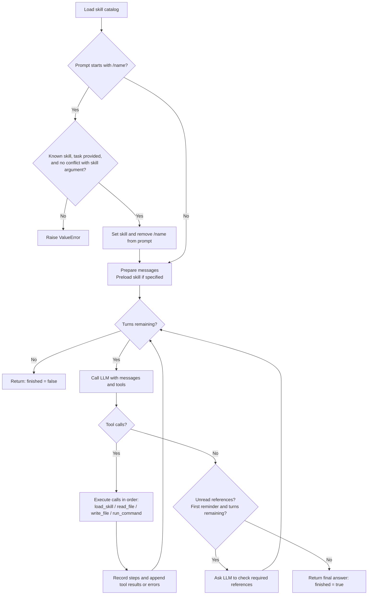

# Modules

## SkillsRunner

`src/module/skills.py` provides `SkillsRunner`, which lets the Python `openai` client load and run skills through any OpenAI-compatible API.

```bash
uv pip install -U openai pyyaml pytest
```

### Demo

* [skill_demo](skill_demo.py)

    ```bash
    python -m src.skill_demo
    ```

    ```python
    from src.module.skills import SkillsRunner

    runner = SkillsRunner(
        ["path/to/skills", "path/to/one-skill"],   # A skill directory or a directory containing multiple skills
        base_url="http://localhost:19001/v1",
        model="sonnet",
        workdir=".",                               # Directory for tool execution and file reads/writes
    )
    result = runner.run("Give me a checksum report for input.txt.")

    result.content    # Final response
    result.steps      # Tool call history: name / arguments / result
    result.finished   # False if max_turns is reached without a final response
    ```

- Recursively searches the supplied paths for `SKILL.md` files and reads `name` and `description` from their frontmatter.
- Workflow: the system prompt lists only skill names and descriptions → the model calls `load_skill` to retrieve the full content → it uses `read_file` / `write_file` / `run_command` to carry out the task → a response without tool calls becomes the final answer.
- `run(prompt, skill="name")` or `run("/name task")` can preload a specific skill, e.g. `run("/sepia review\nYour text here")`.
- Other parameters: `max_turns=20`, `command_timeout=120`, `temperature=0.0`, and `verbose=True` (prints tool calls to stderr).
- `run_command` executes shell commands directly on the local machine without a sandbox. Only load trusted skills.

### LLM and skill execution flow

The LLM selects skills and tools. SkillsRunner executes the calls and returns their results to the LLM.



`load_skill` returns instructions and bundled-file names. The LLM then requests any needed file reads or commands. Before finalizing, the runner may send one reminder to check unread references.

### Tests

```bash
python -m pytest src/test -v                    # All tests; acceptance tests are skipped if the server is unavailable
python -m pytest src/test -v -s -k acceptance   # Acceptance tests (localhost:19001, sonnet); -s shows skill steps and LLM output
```

Use `SKILLS_RUNNER_BASE_URL` and `SKILLS_RUNNER_MODEL` to change the server and model.

## Telegram API


* **Start**

```bash
# install
uv pip install telethon
```

Create an application at https://my.telegram.org, then configure:

```bash
export TELEGRAM_API_ID=<your-app-id>
export TELEGRAM_API_HASH=<your-api-hash>
# user session will save to TELEGRAM_SESSION for next access
export TELEGRAM_SESSION=./reader

# first login
python -m src.module.telegram login --phone <your-phone-number>
```

* **Usage**

```bash
# show broadcast channel only
python -m src.module.telegram list

# include ordinary Telegram groups
python -m src.module.telegram list --all-channel

# > {
# >   "channels": [
# >     {
# >     ...
# >       "title": "Gooaye 股癌",
# >       "username": "Gooaye",
# >       ...
# >     }
# >   ]
# > }
# 

# read messages
# --mark-read: clear notifications
python -m src.module.telegram read "Gooaye" --limit 4 --mark-read

# read an ordinary group (only enabled explicitly)
python -m src.module.telegram read "-1003366841830" --all-channel

# > ...
# >   "messages": [
# >     {
# >       ....
# >       "date": "2026-09-30T08:06:30+00:00",
# >       "edit_date": null,
# >       "text": "EP701 | 🐡\n\n願氣氛降臨 !\n\n本集節目由【NordVPN】贊助\n\nNordVPN 限量優惠活動開跑！\n即日起至 2026/10/21，前往 https://nordvpn.com/gooaye \n並使用折扣碼gooaye，除了享有 NordVPN 獨家優惠方案，加贈 4 個月，還可最高領取 NT$1,200 7-ELEVEN 禮券 \n數量有限，送完為止！ 想拿禮券的朋友記得趕快把握這波優惠喔～\n活動詳情與贈品領取方式請以官方網站公告為準。\n\n股癌傳送門：https://linktr.ee/gooaye",
# >       ...
# >     }
# >   ]
# > }
...
```
